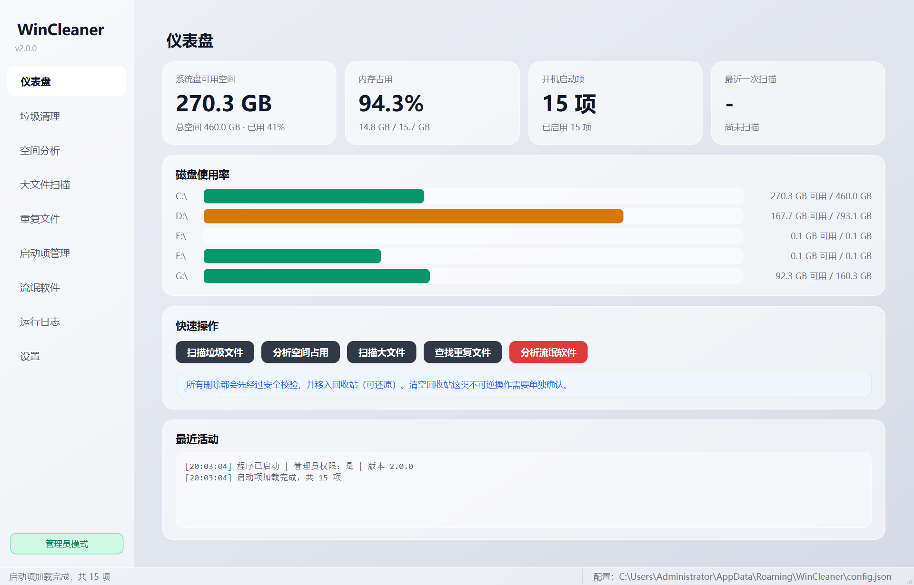
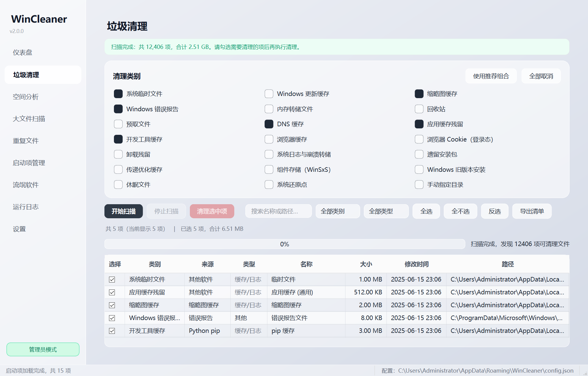
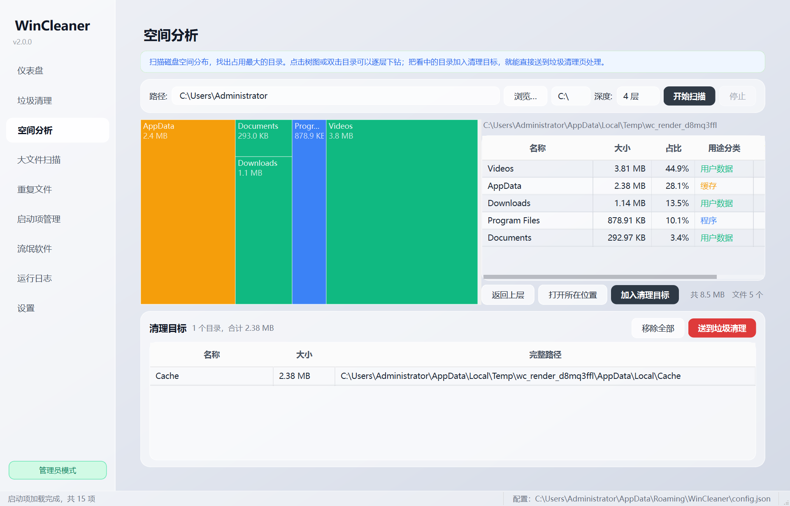
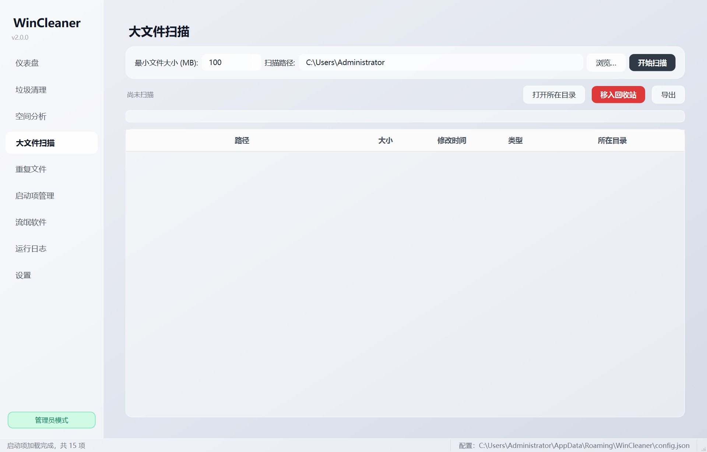
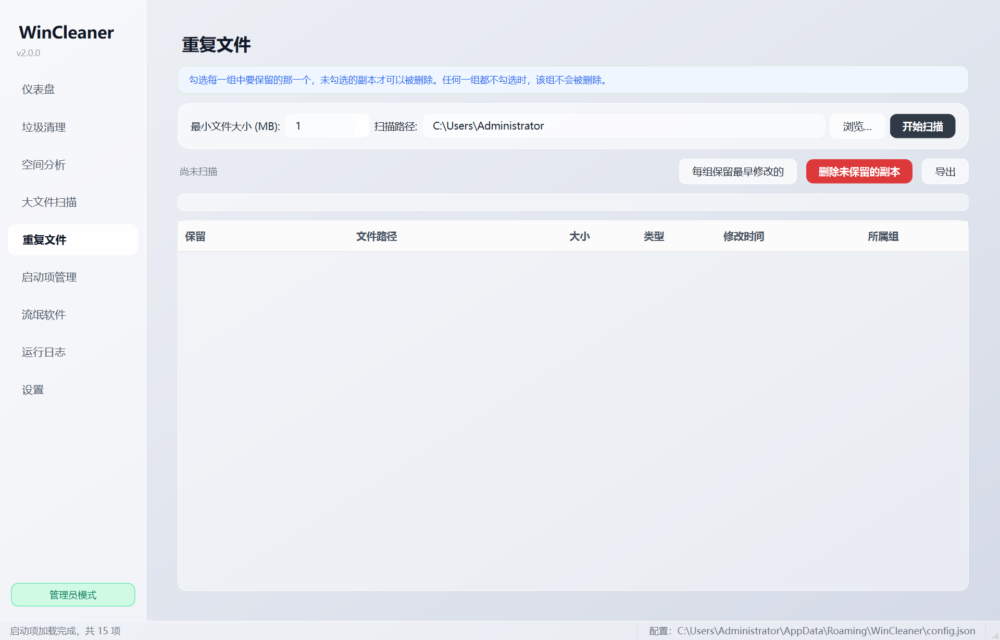
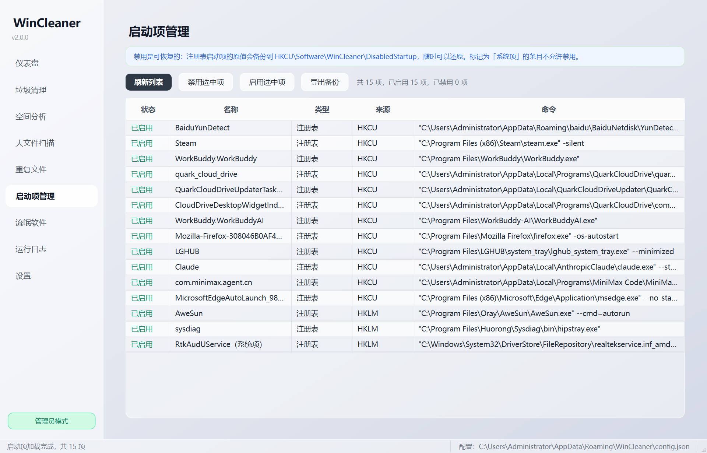
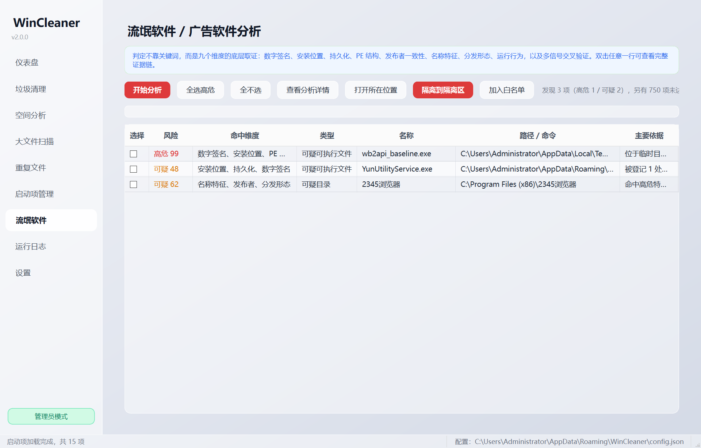
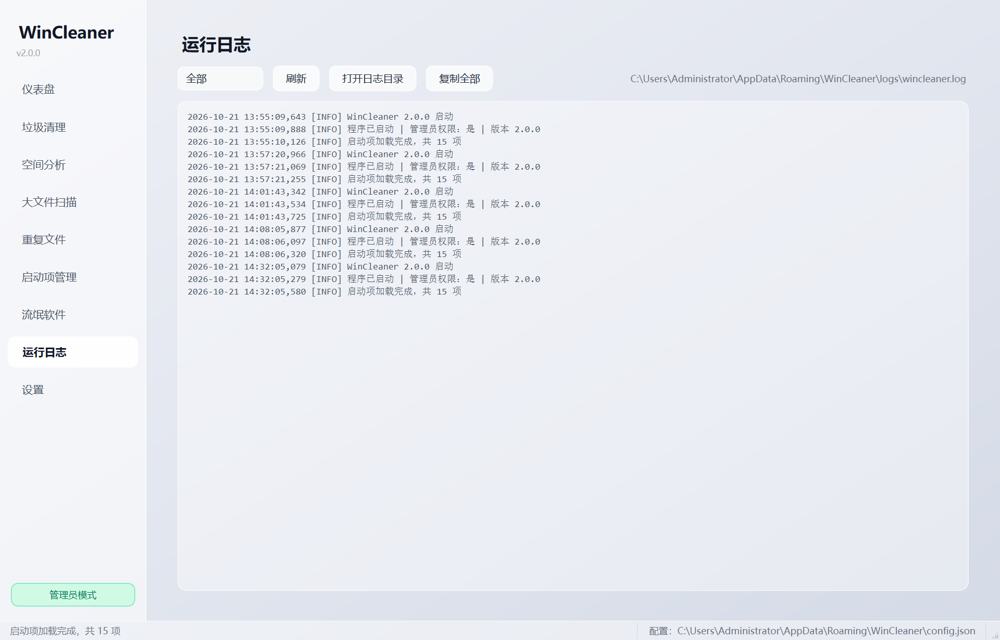
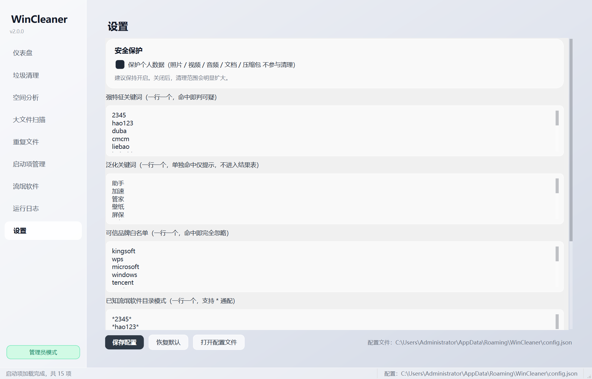

# WinCleaner

Windows 系统清理与安全分析工具（Python 3.12 + PyQt6）。

> ⚠️ **安全优先的设计**：所有删除动作都会先经过安全闸门，并且**默认移入回收站（可还原）**，
> 唯一不可逆的操作（清空回收站 / 关闭休眠 / 删除卷影副本）需要显式勾选并二次确认。

---

## 界面预览

<details open>
<summary><b>点击展开 9 个页面截图</b></summary>

| 主面板 | 垃圾清理 | 空间分析 |
|:---:|:---:|:---:|
|  |  |  |

| 大文件扫描 | 重复文件 | 启动项管理 |
|:---:|:---:|:---:|
|  |  |  |

| 流氓软件分析 | 运行日志 | 设置 |
|:---:|:---:|:---:|
|  |  |  |

</details>

### 下载

- **Releases 页**提供免安装单文件 `WinCleaner.exe`（约 36 MB，双击即用）。
- 也可以用源码运行，见下方[快速开始](#快速开始)。

---

## 功能

| 模块 | 能力 |
|---|---|
| **垃圾清理** | 21 个清理类别：系统临时文件、浏览器缓存、缩略图、错误报告、崩溃转储、预取、开发工具缓存、传递优化、系统日志、遗留安装包、卸载残留、组件存储（DISM）、Windows.old、休眠文件、还原点、回收站、DNS 缓存… |
| **空间分析** | squarified 矩形树图 + 可排序目录表，逐层下钻定位空间大户；看中的目录可一键送进清理流程 |
| **大文件扫描** | 按大小阈值递归查找，可移入回收站 |
| **重复文件** | 按内容哈希（MD5）分组比对，每组保留一个，其余可删 |
| **启动项管理** | 枚举 Run/RunOnce/启动文件夹/服务/计划任务；禁用**可恢复**（原值备份到 HKCU） |
| **流氓软件分析** | 九维底层取证（数字签名 / 安装位置 / 持久化 / PE 结构 / 发布者 / 名称 / 分发形态 / 运行行为 / 交叉验证），输出 0-100 风险分与完整证据链 |
| **运行日志** | 真实日志文件读取、级别过滤、打开日志目录 |
| **设置** | 关键词/白名单/缓存路径编辑 + JSON 校验 + 恢复默认；个人数据保护、清理前建还原点 |

---

## 安全设计

```
扫描（只读）
  └─ 记录允许根目录 root、mtime、size
清理
  └─ check_delete_allowed()  ← 唯一的准入判断
       ① 路径合法性 / 非盘符根
       ② 非系统关键区 / 非回收站条目
       ③ 必须落在允许根目录内
       ④ 文件年龄 ≥ 类别门槛
       ⑤ 非安装载荷 / 非个人数据（可关闭）
       ⑥ 未被进程占用
       ⑦ 权限满足
  └─ delete_to_recycle_bin()  ← 唯一删除出口（SHFileOperationW + FOF_ALLOWUNDO）
  └─ 写 clean_actions.log 审计日志（成功与失败都记）
```

其它保障：

- 清理类别默认**不勾选**高危项（回收站 / 还原点 / 休眠 / Cookie / 卸载残留 / 组件存储）
- 每次清理写入 `history.json` 历史，可追溯
- 可选在清理前自动创建**系统还原点**
- 应用安装目录、数据目录永远受保护（跨盘符一致，不只保护 C 盘）

---

## 快速开始

```powershell
# 1. 创建虚拟环境
py -3.12 -m venv .venv

# 2. 安装依赖
.venv\Scripts\python.exe -m pip install -r requirements.txt

# 3. 运行
.venv\Scripts\python.exe main.py
```

也可以直接双击项目根目录的 **`启动WinCleaner.bat`**（无控制台窗口）。

### 打包成 exe

```powershell
.venv\Scripts\python.exe build_exe.py              # 正常打包
.venv\Scripts\python.exe build_exe.py --uac-admin  # 始终以管理员身份运行
```

产物在 `dist\WinCleaner.exe`（单文件，约 36 MB）。

---

## 目录结构

```
core/
  safety.py          # 安全策略层：类别定义 + 唯一准入判断
  utils.py           # 通用工具：回收站 API、路径判定、格式化
  scanner.py         # 垃圾扫描引擎
  cleaner.py         # 清理执行引擎（含 DISM / powercfg / vssadmin 特殊动作）
  config.py          # 配置管理（单一数据源 + 版本迁移）
  analyzer.py        # 九维取证分析引擎
  pe_inspect.py      # 内置 PE 解析器（节区熵 / 壳 / 导入表）
  signature.py       # Authenticode 签名校验 + 版本元数据
  space_analyzer.py  # 磁盘空间分析
  leftovers.py       # 卸载残留检测 + 浏览器缓存规则
  clean_history.py   # 清理历史 + 系统还原点
  startup_manager.py # 启动项管理（可恢复的禁用）
ui/
  main_window.py     # 主窗口
  space_page.py      # 空间分析页
  treemap.py         # 矩形树图控件
  models.py          # 表格数据模型
  widgets.py         # 通用小部件
  workers.py         # 后台线程
audit/
  verify_wincleaner.py   # 安全不变量回归（114 项断言）
  smoke_test.py          # 启动冒烟
  core_selftest.py       # 核心层自检
  analyzer_test.py       # 取证引擎标定
  adware_scan_test.py    # 端到端扫描与性能基准
  render_pages.py        # 渲染界面截图
```

---

## 测试

```powershell
.venv\Scripts\python.exe audit\verify_wincleaner.py   # 安全不变量：114 项
.venv\Scripts\python.exe audit\smoke_test.py           # 启动冒烟
.venv\Scripts\python.exe audit\core_selftest.py         # 核心自检
```

---

## 文档

- [`AUDIT_REPORT.md`](AUDIT_REPORT.md) —— 2026-10-14 初始审计报告（发现了哪些问题）
- [`FIX_REPORT.md`](FIX_REPORT.md) —— 修复报告（逐条对应的修复方式）

---

## 许可

仅供个人学习与本机维护使用。
